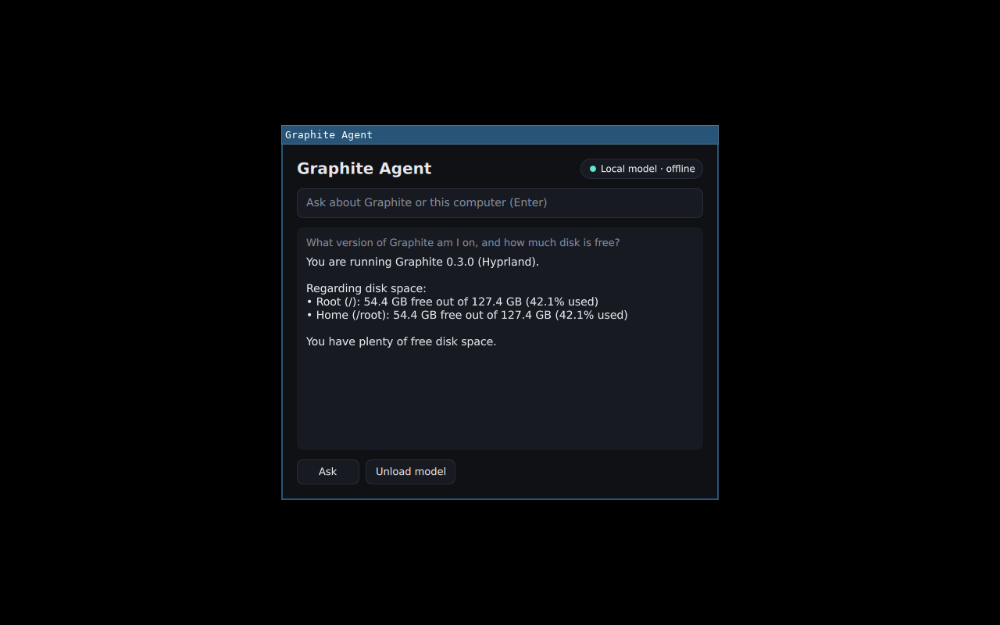
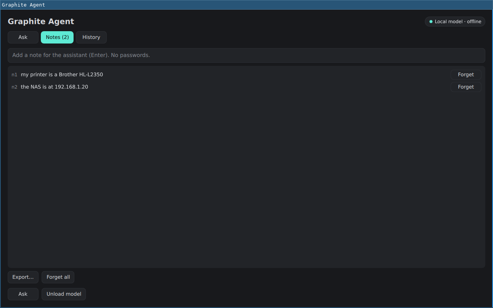
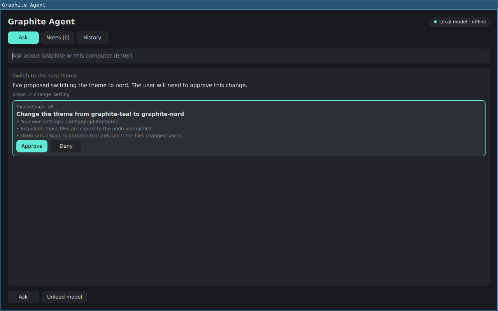
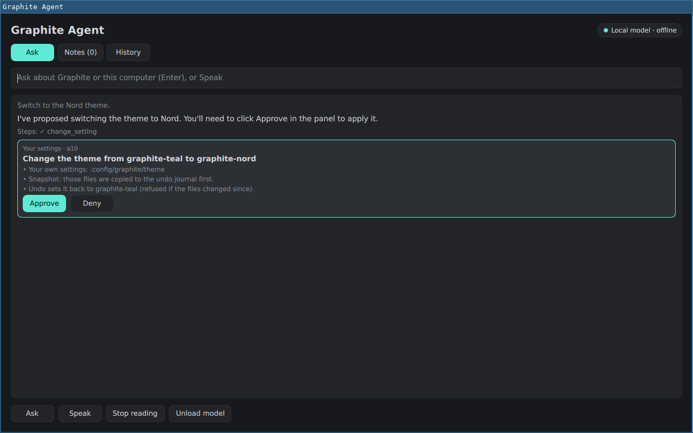
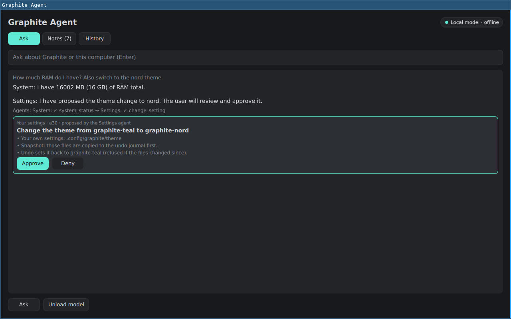
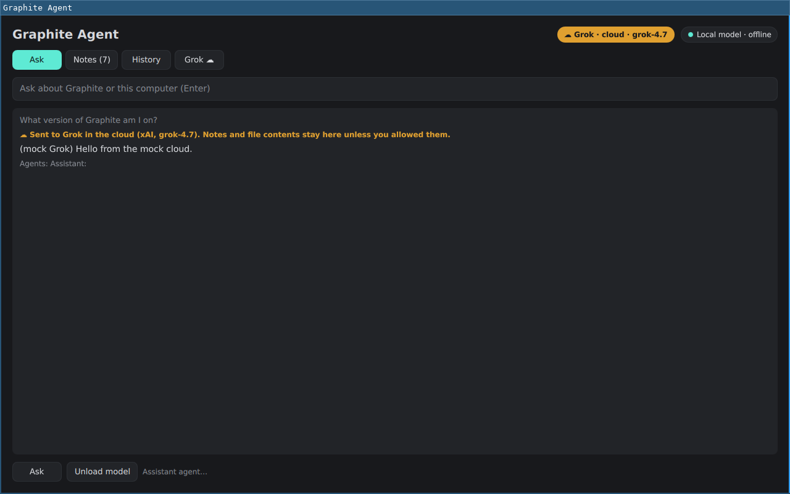
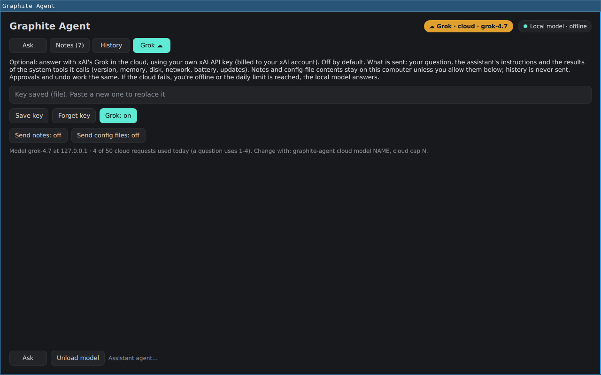

# Graphite Agent

An offline assistant: **Super+Shift+A** (or `graphite-agent toggle`) opens a Quickshell
panel; questions go to a local Qwen3.5-2B (Q4_K_M) model run by llama.cpp on `127.0.0.1:8081`.
Nothing leaves the computer unless you turn on the optional Grok tier (Stage 6). Installed by default: both packages are `graphite-desktop` dependencies.

| Package | Contents |
|---|---|
| `graphite-agent` | `/usr/bin/graphite-agent` (stdlib Python CLI + session daemon), the panel (`/usr/share/graphite-agent/quickshell/shell.qml`, copied to `~/.config/quickshell/graphite-agent`), `graphite-llm.service` (systemd **user** unit, never enabled), `graphite-agent.socket` + `.service` (session daemon, socket enabled for all users), bundled help + keybind list. Depends on `python llama-cpp quickshell`. |
| `graphite-agent-model` | `/usr/share/graphite-agent/models/Qwen_Qwen3.5-2B-Q4_K_M.gguf` (1,396,198,496 bytes, Apache-2.0), downloaded at package build from pinned Hugging Face commits and checked against a pinned sha256. |

## What it can do
Nine read-only tools, validated in `graphite-agent` (not by the model): `os_release`
(Graphite version, graphite-config, Hyprland, kernel), `system_status` (RAM, swap, disk on / and
home in GiB, uptime, load), `graphite_help` (bundled help: keybinds, apps, settings, updates),
`network_status` (interfaces, addresses, active connections, default route; no network traffic),
`battery_status`, `recent_updates` (pacman.log), `failed_services` (system + user),
`read_config` (files under `~/.config/{hypr,graphite,kitty,quickshell,mako,waybar,gtk-3.0,gtk-4.0}`
and a few `/etc` files; symlinks resolved first, secret-looking lines redacted) and
`search_notes`. Unknown tools or arguments are refused. No shell, no file edits by the model.

## Session daemon (Stage 2)
`graphite-agent.socket` (enabled for every user by the package) listens on
`$XDG_RUNTIME_DIR/graphite-agent/agent.sock` (0600 in a 0700 dir; the daemon also checks the
peer UID). The first request starts `graphite-agent.service` (`graphite-agent daemon`, the
logged-in user, never root); it exits after 10 idle minutes. Without a systemd user session the
CLI starts the daemon itself, and if that fails it answers in-process with the same rules.
Requests are single JSON lines (64 KiB max).

Each question is a persisted task: `running` -> `done` / `failed` / `cancelled` / `interrupted`.
A task cut off by a crash or restart is marked `interrupted` on the next start and is never
replayed. One answer runs at a time (a second one is refused while busy). Limits: 3 tool rounds,
6 tool calls, the same call twice refused, 180 s per question, 5 s per tool subprocess, 3,000
characters per tool result. Stop (or closing the client) cancels: the daemon closes the model
request, so llama-server stops generating.

`~/.local/share/graphite-agent/agent.db` (SQLite WAL, 0600, `secure_delete`): tasks, an audit
log of every tool call and state change, and notes.

## Changes: propose, approve, undo (Stage 3)
Three more tools only **propose** a change: `change_setting` (theme, bar, scale, kb_layout,
kb_variant, sensitivity, natural_scroll, follow_mouse; same value rules as `graphite-settings`,
themes must be installed), `install_app` (official core/extra/multilib packages) and `remove_app`
(installed packages nothing depends on). Kernels, firmware, base, systemd, pacman, sudo, boot,
snapshot, desktop and graphite-* packages are refused (protected list). The proposal is
validated in `graphite-agent`, stored as `awaiting_approval` (expires after 10 minutes, one per
question) and shown as a card: what changes, what the snapshot covers, what Undo does. The model
is told nothing has changed.

Only **Approve** runs it: the panel runs `graphite-agent approve ID` in the desktop session. The
action is claimed atomically (no double run), validated again, then:
- **your settings**: the files it touches (`~/.config/graphite/settings.conf` + `settings.lua`,
  `theme` or `bar`) are copied to `~/.local/share/graphite-agent/undo/ID/` (content, mode,
  sha256), then `graphite-settings set` / `graphite-theme set`, then the value is read back.
- **software**: `pkexec /usr/lib/graphite-agent/graphite-agent-helper` (polkit
  `org.graphiteos.agent.packages`, `auth_admin`: your password every time). The helper is the
  only privileged part; it checks names and the protected list again, official repos only, 2 GiB
  free, no pacman lock, takes a snapper snapshot of / and verifies it is listed. If the snapshot
  fails nothing is changed. It records exactly which packages the transaction added or removed.

**Undo** (History tab, `graphite-agent undo ID`): settings go back to the old value and the
journaled bytes are restored; refused if the files changed since (your edits are never
overwritten). Software undo removes exactly the packages the install added (`pacman -Rn`), or
reinstalls exactly what a removal took (`--asdeps` restored), with another snapshot first.
Root snapshots don't cover /home or /boot; for a full system rollback use `graphite rollback N`
(the card and the result name the snapshot number). An approve/undo interrupted by a crash is
marked `interrupted`/`undo_failed` and never re-run. Not yet: Flatpak apps, editing arbitrary
files, multi-step changes.

## Voice (Stage 4)
Offline both ways, nothing leaves the computer and no audio is kept:
- **Speech in**: Speak in the panel, or **Super+Alt+A** (opens the panel and starts listening;
  press again, Esc or Stop to finish). `pw-record` captures 16 kHz mono from the default
  microphone into `$XDG_RUNTIME_DIR/graphite-agent/` (RAM, 0700 dir, 0600 file), stopping by
  itself after 30 s. The red **Mic on · N s / 30 s** pill shows whenever it records. The file
  goes to the session daemon, which runs `whisper-cli` (Arch `whisper-cpp`) with
  `ggml-base.en-q5_1.bin` (package `graphite-agent-voice-model`, 59.7 MB, pinned commit +
  sha256) under the same lock as answers (never both at once), then deletes the file. A
  recording left by a killed process is removed on the next use; the recorder dies with its
  parent. Silence gives "I didn't hear anything"; whisper's markers ([BLANK_AUDIO]) are dropped.
  The transcript is asked like typed text: proposals still need Approve. `graphite-agent listen`
  (terminal), `listen --file WAV`.
- **Speech out**: a spoken question's answer is read aloud with RHVoice (`rhvoice` +
  `rhvoice-voice-slt`, English "slt"); Read aloud / Stop reading in the panel,
  `graphite-agent say TEXT|-`, `say --stop`. Markdown, links and note citations are not read.
- English only for now (base.en). `graphite-agent setup-model --voice` repairs the model (local
  package first, else download, sha256).


Notes are saved only when you ask: type "remember ..." (handled by the CLI, never by the model),
use the panel's Notes tab, or `graphite-agent remember "..."`. Text that looks like a password,
key or token is refused. Matching notes (SQLite FTS5, BM25) are added to the question, labelled
as facts rather than instructions, and the panel shows which ones were used (`n3`). Forget
deletes a note for good (FTS index optimised, VACUUM, WAL truncated); export writes JSON (0600).
History (questions, answers, audit) is kept 30 days; `graphite-agent history off` stops saving
question/answer text, `history clear` deletes it all. No embeddings yet (FTS5 keyword search only).

## Commands
```
graphite-agent toggle|open|close   panel (closing also cancels a running answer)
graphite-agent ask "question"      one answer in the terminal (--jsonl: the panel's format)
graphite-agent cancel              stop an answer in progress (Stop in the panel)
graphite-agent unload              stop graphite-llm and free its RAM (Unload model in the panel)
graphite-agent status [--json]     model / service / server / daemon state
graphite-agent remember "text"     save a note; notes [--json]; forget ID|--all; export [FILE]
graphite-agent history [N]|on|off|clear, audit [TASK]   recent questions, tool-call audit log
graphite-agent setup-model         repair/fallback: verify the model, else put a copy in
                                   ~/.local/share/graphite-agent/models from a local
                                   graphite-agent-model package (live ISO: /opt/graphite-repo)
                                   or a download, sha256-checked (--llm / --voice: one model)
graphite-agent listen [--jsonl]    record a question (until listen --stop or 30 s), print the text
graphite-agent say TEXT|-          read text aloud; say --stop
graphite-agent voice               Super+Alt+A: open the panel and start/stop listening
graphite-agent agents [on|off]     the specialist agents and their tools; off = one agent
graphite-agent cloud [status|on|off|key|forget-key|model NAME|cap N|share-notes on|off|share-files on|off]
                                   the optional Grok tier (key from stdin only)
```
The model service starts on demand (opening the panel warms it up) and drops the weights after
15 idle minutes. Extra llama-server flags go in `~/.config/graphite/agent.env`, e.g.
`GRAPHITE_LLM_ARGS="-t 4"`.

## Several agents (Stage 5)
A coordinator hands each question to one or more named specialists, one after another on the
**same** local model (one llama-server, one answer at a time under the daemon's lock: no extra
RAM, no second model). The coordinator makes one short grammar-constrained JSON plan
(`response_format` json_schema: agent names are an enum, at most 3 steps); every specialist then
gets its own short prompt and **only its own tools** (a call to any other tool is refused in
`graphite-agent`, outside the model):

| Agent | Tools |
|---|---|
| System | os_release, system_status, network_status, battery_status, recent_updates, failed_services, read_config (read only) |
| Settings | change_setting, graphite_help |
| Software | install_app, remove_app, graphite_help |
| Notes | search_notes |
| Help | graphite_help |
| Assistant (general) | every tool, the Stage 4 prompt |

Later agents get a short summary of what earlier ones found (labelled as data). If the plan
doesn't parse, names an unknown agent or has more than 3 steps, the general agent answers alone
(the Stage 4 behaviour); `graphite-agent agents off` (or *Multiple agents: off* in History)
always does that. Limits per question: 3 hops, 6 tool calls shared by all hops, 3 tool rounds
and 120 s per hop, 30 s for the plan, 180 s in total. **Changes are unchanged**: specialists can
only *propose*, at most one change per question across all hops, and only Approve on the card
runs it (with its snapshot and undo); System, Notes and Help have no change tools at all.

The audit log (`graphite-agent audit TASK`) records the plan, every hop (`hop`, `hop_done` with
its tool-call count) and tags each tool call with its agent; `history --json` lists the agents
per question. The panel shows "Agents: System: ✓ system_status → Settings: ✓ change_setting",
"proposed by the Settings agent" on the card, and the agents per question in History.

Measured on the box (8 threads, `-t 4`, Qwen3.5-2B Q4_K_M), 13 test questions: every one routed
to the right agent(s), including the compound ones ("How much RAM do I have? Also switch to the
nord theme" -> System + Settings; with agents off the single agent called battery_status and
couldn't answer the RAM part). Cost: one extra short model call per question, about 2-5 s
(simple questions 5-11 s instead of 4-6 s; two-agent questions 11-20 s). A 2B model still
sometimes repeats itself in a second hop.

## Optional Grok tier (Stage 6)
**Off by default**; nothing changes for anyone who doesn't turn it on. The panel's **Grok** tab
(or `graphite-agent cloud ...`) takes the user's **own** xAI API key and an on/off switch.

- **Key**: pasted into a password field and handed to `graphite-agent cloud key` on **stdin**
  (never a command-line argument). Stored in the user's keyring through Secret Service
  (`secret-tool`, libsecret; e.g. gnome-keyring or KeePassXC) under
  `service=graphite-agent account=xai-api-key`; without a keyring daemon (the default Graphite
  install has none) in `~/.config/graphite-agent/xai-api-key`, 0600 in a 0700 dir (a key file
  others can read is ignored). Never printed, logged, put in the db/audit or in argv; status
  shows only *keyring* / *file* / *none*. `cloud forget-key` removes it and turns the tier off.
- **Requests**: HTTPS (certificate verified) to `https://api.x.ai/v1/chat/completions`, the
  OpenAI-compatible endpoint, streamed, `Authorization: Bearer` header. Model `grok-4.7` by
  default (`cloud model NAME`). Same tools (validated and run on this computer) and the same
  approval cards + undo; one agent with every tool (no coordinator call: Grok handles the
  full tool list, and it saves a request).
- **What is sent**: the question, the assistant's instructions and tool schemas, and the results
  of the system tools the model calls (version, RAM/disk, network interfaces and Wi-Fi name,
  battery, updates, failed services). **Not sent** unless the user opts in: notes
  (`cloud share-notes on`; a question that matches a note stays local) and config-file
  contents (`read_config` is not offered or allowed: `cloud share-files on`). History is never
  sent; each question stands alone.
- **Indicator**: an amber **☁ Grok · cloud · MODEL** pill and a "Sent to Grok in the cloud" line
  on the answer; ☁ next to cloud answers in History; `backend` events in the audit log; the CLI
  prints `[Sent to Grok in the cloud (MODEL)]` on stderr.
- **Fallback**: no key, plain http (except localhost, for tests), a failed TLS check, offline,
  a timeout (60 s without data), any HTTP error (401 bad key, 429 no credits, 5xx) or a stream
  that ends early -> the local model answers the rest of that question, and the panel says why.
  Only a status code is reported, never a response body.
- **Daily cap**: 50 cloud requests per day by default (`cloud cap N`; a question uses 1-4: one
  per model round). After that, local until midnight.

Tested only against a local HTTPS mock (`tests/agent-check.sh`): no real API calls, no real key.

## ISO and installer
`graphite-agent-voice-model` (59.7 MB, whisper base.en q5_1) is handled exactly like the LLM
package below: in `/usr/share/graphite-agent/models` (NoExtract on the live ISO), copied to the
target once by `pacman -U` from the ISO. Voice adds about 66 MB to the ISO (model 59.7 MB +
whisper-cpp 0.9 MB + rhvoice/english/slt 6.0 MB compressed; ffmpeg, ggml, speech-dispatcher,
portaudio and pipewire-audio are already on it) and about 76 MB installed.

The packages are dependencies of `graphite-desktop` (graphite-meta pkgrel 13), so existing
installs get them on `graphite update` (`pacman -Syu`; the model is a ~1.37 GB download from the
[graphite] repo). On the live ISO the model package is registered but its GGUF is not extracted
(`NoExtract` in the archiso profile's `pacman.conf`): it ships once, as the package in the ISO's
`/opt/graphite-repo` (extracting it too would store 1.4 GB twice in the squashfs).
`graphite-iso-install` copies the bundled repo to the target **without** that package and runs
`pacman -U` on it straight from a read-only bind mount of the ISO repo (pacman reads `-U` files in
place: no cache copy), so the target stores the model once. `install.sh`'s
`pacman -S --needed ... graphite-agent-model` then skips it; updates come from the remote repo.

## Tests
`tests/agent-check.sh`: offline checks against a scripted mock llama-server (tool allowlist,
argument validation, a forced `delete_files` call, the 3-round cap, serve flags, model pins,
cancel matching only the ask process; Stage 2: daemon socket modes, busy refusal, cancel through the daemon and on client exit, crash -> interrupted without replay, call budget, deadline, oversized requests, read_config path escapes and symlinks, notes retrieval/forget/export, nothing left in the db after forget; Stage 3: proposals change nothing, approve/undo/deny/expiry, undo conflict refusal, invalid values and protected packages refused, one proposal per question, failed snapshot blocks the change, crash -> interrupted, helper as root with a stand-in snapper: real pacman install/undo, injection refused; Stage 4 with a fake recorder/whisper/RHVoice/player: listen -> stop -> text, 0600 file in RAM deleted after transcription, transcription in the daemon and refused while an answer runs, silence, the 30 s cap, no orphan recorder after a kill, no paths or symlinks via the socket, say strips markdown and stops at once, voice model pin and ISO wiring, Super+Alt+A; Stage 5: the plan request shape, one-step plans behave like Stage 4, specialists offered and allowed only their tools, a change by the Settings agent is still only a proposal, two hops with the hand-off and audit trail, agents without change tools can't propose, one proposal across hops, the shared call budget, five kinds of bad plan -> one general agent, the per-hop time limit, agents off, the tool-call-as-text filter; Stage 6 against a local HTTPS mock with a self-signed CA and a stand-in secret-tool: off by default, key only via stdin into the keyring or a 0600 file, request shape (path, Bearer, model, no notes/config tools), proposals unchanged, read_config and notes kept local unless opted in, fallback on 401/500/dropped stream/unreachable/untrusted certificate/plain http, the daily cap and its reset, cancel, the key absent from argv, db, WAL, audit and output, forget-key). `tests/smoke.sh` (VM) checks the package, the bind and
that graphite-llm is not running at login.







